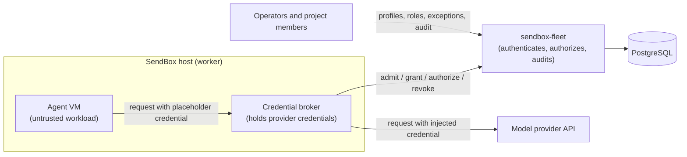

# Architecture

`sendbox-fleet` is the shared governance service for SendBox governed sessions
([mbianchidev/sendbox#87](https://github.com/mbianchidev/sendbox/issues/87)).
It is increment 2 of that issue: the authenticated, multi-user management API
and central authority that increment 1 deliberately left out.

**Status: scaffold.** The service runs, authenticates every `/v1` request,
validates request bodies against the shared contract, and answers every
management operation with `501 Not Implemented`. No governance decision is
made yet. See [roadmap.md](roadmap.md).

## Relationship to SendBox increment 1

Increment 1 lives in the [sendbox](https://github.com/mbianchidev/sendbox)
repository and works on a single host:

- An operator signs a governance profile (the maximum a session may do). The
  host verifies it and binds its digest and revision into the session plan.
- `LocalGrantAuthority` (in `sendbox-governance`) issues, authorizes, renews,
  and revokes credential grants in process.
- The host credential broker holds provider credentials and injects them into
  approved upstream requests. Agents only ever see a placeholder.

Increment 2 moves the *authority* off the host, so several hosts and users
share one set of profiles, roles, grants, exceptions, and audit evidence. The
fleet implements the same `GrantAuthority` semantics over HTTP; a SendBox host
uses a remote authority client instead of the local one.



## Trust boundaries

1. **Workload to host broker.** The agent VM is untrusted. It never receives
   provider credentials, and it cannot choose the principal, project, session,
   policy revision, or upstream that a request is attributed to. The broker
   builds every `RequestContext` from trusted host state.
2. **Host to fleet.** A SendBox host is an authenticated *worker* principal.
   The fleet never holds provider credentials: credential injection stays in
   the host broker, and the fleet only decides (admission, grants,
   per-request authorization) and records evidence. A
   compromised fleet can therefore authorize misuse but cannot leak provider
   keys; a compromised host is limited to the sessions and grants the fleet
   issued to it.
3. **People to fleet.** Operators and project members are authenticated *user*
   principals. What they may do is decided by project-scoped roles.
4. **Fleet to database.** The database stores identifiers, digests, signed
   profile bytes, and audit evidence. It stores no credentials, tokens,
   authorization headers, or request bodies; there are no columns for them.

## Authentication is separate from authorization

- **Authentication** answers "who is calling". Every `/v1` request passes
  through `auth::require_bearer` *before* routing, so an unauthenticated
  request is rejected with `401` before its body is read. Only
  `Authorization: Bearer <token>` is accepted. Identity headers such as
  `X-Forwarded-User`, `X-Remote-User`, or `X-Sendbox-Principal` are ignored.
  The `Authenticator` trait maps a token to a `Caller` (principal and kind).
  No identity provider is integrated yet: the production
  `UnconfiguredAuthenticator` rejects every token with
  `authentication provider not configured`.
- **Authorization** answers "may this caller do this". It will combine the
  caller kind (user or worker), project roles (`owner`, `admin`, `member`,
  `viewer`), the current profile ceiling, admitted sessions, grants, and
  approved exceptions.
- **Workload identity fields are never authoritative.** Principal and project
  fields inside request bodies (for example `GovernanceBinding.principal`) are
  claims to check against the authenticated caller and stored state, never a
  source of identity. `local-user:` principals belong to single-host
  increment 1 and are rejected by both the API and the schema.

## Planned request flow

| Step | Endpoint | Contract types | Planned checks |
| --- | --- | --- | --- |
| Admit a session | `POST /v1/sessions:admit` | `SessionRef`, `GovernanceBinding` | Caller is a worker; principal holds `member` or higher in the project; profile revision is current (at or above the minimum, inside its validity window, digest matches); binding digest recorded |
| Issue a grant | `POST /v1/grants` | `GrantRequest` to `CredentialGrant` | Session admitted by this worker; binding digest matches; service admitted by the binding; methods and paths inside the profile; bounded lease and TTL |
| Authorize a request | `POST /v1/authorize` | `RequestContext` to `Decision` | Same checks as `LocalGrantAuthority::authorize`, against shared state. Hosts treat any non-200 answer as `authority_unavailable` and deny |
| Renew a lease | `POST /v1/grants/{grant_id}:renew` | `GrantId` to `CredentialGrant` | Not revoked, not expired, profile still current; lease never exceeds the grant's hard expiry |
| Revoke a grant | `POST /v1/grants/{grant_id}:revoke` | `RevocationReason` | New requests denied immediately; open streams may finish within the grace window (at most 60 seconds); completed external effects are not reversed and are audited with outcome `unknown` when unconfirmed |
| Read or publish a profile | `GET` / `PUT /v1/profiles/{profile_id}` | `ProfileId`, `GovernanceProfile`, `ProfileRef` | Publication by an operator; signature verification over the exact bytes |
| List or assign roles | `GET` / `POST /v1/projects/{project_id}/roles` | `ProjectId`, `PrincipalId` | Only `owner` assigns roles |
| Request an exception | `POST /v1/exceptions` | `ProjectId`, `PrincipalId`, `ProfileRef` | Bounded scope, reason, expiry at most 7 days; approval by a different authorized principal; never wider than the profile ceiling; bound to the exact revision |
| Query audit events | `GET /v1/audit/events` | `ProjectId`, `SessionRef`, `PrincipalId`, `DenyReason` | Role-scoped visibility; cursor pagination |

Project identifiers contain a slash (`github:owner/repo`), so clients
percent-encode it in paths: `/v1/projects/github:owner%2Frepo/roles`.

## HTTP responses

Errors use RFC 9457 `application/problem+json` with `type: about:blank`, the
standard reason phrase as `title`, and a specific `detail`. `501` responses add
a `capability` member naming the unimplemented increment-2 capability.

| Status | When |
| --- | --- |
| `400` | Body, path, or query does not match the contract |
| `401` | Missing, malformed, or unaccepted bearer token (with `WWW-Authenticate: Bearer`) |
| `404` / `405` | Unknown path or unsupported method |
| `413` / `415` | Body too large (64 KiB, 1 MiB for profile publication) or not JSON |
| `501` | Valid, authenticated request for an increment-2 capability |
| `503` | `/readyz` cannot reach the database |

`GET /healthz` (liveness) and `GET /readyz` (database round trip) are
unauthenticated and reveal nothing beyond availability.

## Persistence

`migrations/postgres` and `migrations/sqlite` define the same schema; the
server applies the matching set at startup. PostgreSQL is the shared
deployment target; SQLite is for local development and tests.

| Table | Holds |
| --- | --- |
| `principals` | Authenticated users and workers (never `local-user:`) |
| `projects` | `github:owner/repo` or `path-sha256:` projects |
| `role_bindings` | One project-scoped role per principal per project |
| `profiles` | Exact signed bytes, digest, signatures, validity window per revision |
| `profile_minimum_revisions` | Oldest revision still accepted per profile |
| `sessions` | Admitted sessions with their canonical binding and digest |
| `credential_grants` | Grant scope, lease, hard expiry, generation; no credential material |
| `revocations` | Reason, actor, bounded grace window |
| `exceptions` | Scope, reason, requester, approver, expiry, exact profile revision |
| `audit_events` | Append-only, hash-chained evidence with a redacted target |

Constraints carry the invariants the database can check: identifier grammar,
7-day grant and exception lifetimes, a 60-second revocation grace, approvers
who differ from requesters, grants whose principal, project, binding, and
profile must equal their session's (composite foreign key), and audit rows that
must extend the chain and can never be updated or deleted (triggers). Each
`event_hash` will be SHA-256 over `previous_hash` and the event's RFC 8785
canonical JSON, computed by the service.

## Logging

Structured JSON lines go to stdout and to `sendbox-fleet.YYYY-MM-DD.log` in
`FLEET_LOG_DIR`, rotated at each UTC day and pruned after 30 days. Request
bodies, headers, and query strings are never logged. Details in
[development.md](development.md#logs).

## Code layout

```text
crates/fleet-server/src/
  main.rs          process entry: config, logging, runtime, exit codes
  server.rs        app assembly, startup, graceful shutdown, retention timer
  config.rs        environment configuration and validation
  logging.rs       subscriber setup and request logging middleware
  logging/retention.rs
  db.rs            pools, migrations, readiness ping
  problem.rs       RFC 9457 problem responses
  auth.rs          bearer authentication middleware and Authenticator trait
  routes/          health probes and the /v1 scaffold
migrations/{postgres,sqlite}/
```
